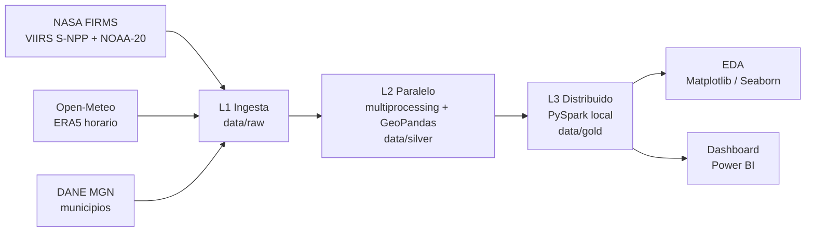

# 🔥 FireWatch Boyacá

**Sistema distribuido de analítica geoespacial para el monitoreo de anomalías térmicas y la estimación de riesgo de incendios de cobertura vegetal en Boyacá, Colombia.**


> Proyecto Integrador · Ingeniería de Datos e Inteligencia Artificial · Cuarto semestre · 2026-2
> Asignaturas: **Redes e Infraestructura** · **Computación Paralela y Distribuida** · **Analítica y Visualización de Datos**

---

## 1. Problema

Boyacá enfrenta incendios de cobertura vegetal recurrentes durante las temporadas secas, con impacto en páramos, bosques andinos, fuentes de agua y medios de vida rurales. Las entidades de gestión del riesgo (CDGRD, Corpoboyacá, cuerpos de bomberos) necesitan **priorizar territorialmente** con información oportuna. Los datos satelitales y climáticos son abiertos, pero están dispersos y no se integran en un indicador accionable a escala municipal.

**FireWatch Boyacá** integra las detecciones de anomalías térmicas satelitales (NASA FIRMS) con variables meteorológicas (reanálisis ERA5) para:

1. Caracterizar la actividad térmica en los 123 municipios del departamento.
2. Estimar un **Índice de Riesgo Relativo de Anomalías Térmicas (IRAT)** por municipio y mes.
3. Comunicar los hallazgos en un dashboard interactivo orientado a la toma de decisiones.

**Alineación ODS:** ODS 13 · metas 13.1 (resiliencia frente a riesgos relacionados con el clima) y 13.3 (capacidad institucional de alerta temprana).

---

## 2. Arquitectura

Pipeline por lotes con patrón *medallion* (`raw → silver → gold`), desplegado lógicamente sobre una red diseñada en Cisco Packet Tracer.



| Capa | Tecnología | Qué hace | Requisito |
|---|---|---|---|
| L0 · Red | Cisco Packet Tracer | Topología de 4 routers, VLSM, OSPF, DHCP y servidores por rol | R2 |
| L1 · Ingesta | Python + `requests` | Descarga reproducible de FIRMS, Open-Meteo y DANE | — |
| L2 · Paralelo | `multiprocessing` + GeoPandas | Limpieza, filtros de calidad y asignación de cada detección a su municipio (Colombia completa) | R3, R5 |
| L3 · Distribuido | PySpark (modo local) | Clima horario→diario, grilla municipio-día, ventanas, línea base e IRAT | R4, R5 |
| L4 · Consumo | Matplotlib, Seaborn, Power BI | EDA y dashboard con KPIs, mapa y drill-down | R6, R7 |

📄 Diseño completo: [`docs/arquitectura.md`](docs/arquitectura.md) · Contratos de datos: [`docs/diccionario_datos.md`](docs/diccionario_datos.md) · Decisiones: [`docs/adr/`](docs/adr/)

---

## 3. Datos

**Ventana temporal:** `2022-01-01 → 2026-10-31` (indicación docente; ver [ADR-0004](docs/adr/0004-ventana-2022-2026.md)).

| Fuente | Producto | Uso |
|---|---|---|
| [NASA FIRMS](https://firms.modaps.eosdis.nasa.gov/) | VIIRS 375 m, S-NPP y NOAA-20 (SP 2022–2025; SP + NRT 2026) | Detecciones de anomalías térmicas |
| [Open-Meteo Historical API](https://open-meteo.com/en/docs/historical-weather-api) | Reanálisis ERA5 (`era5_seamless`), horario, por centroide municipal | Temperatura, humedad, precipitación, viento, ET0 |
| [DANE – MGN](https://geoportal.dane.gov.co/) | Capa de municipios (DIVIPOLA) | Asignación espacial, áreas, centroides |
| Gobernación de Boyacá (Secretaría de Planeación) | Tabla municipio → provincia (`config/provincias_boyaca.csv`, fuente citada en el [diccionario](docs/diccionario_datos.md)) | Provincia en `silver.dim_municipio` (no incorporada al dashboard) |

> Los datos **no se versionan**. Se descargan con `scripts/download_all.py` o se obtienen ya procesados desde la carpeta compartida de OneDrive (sección 6). Ver [`data/README.md`](data/README.md).

---

## 4. Estructura del repositorio

```
firewatch-boyaca/
├── config/          Configuración central (settings.yaml) y semillas
├── data/            raw / silver / gold (no versionado)
├── src/firewatch/   Paquete Python: ingest, parallel, spark, quality, utils
├── scripts/         Puntos de entrada: descarga y pipeline completo
├── benchmarks/      Medición de speedup y eficiencia (resultados versionados)
├── notebooks/       EDA y validación del IRAT
├── tests/           Pruebas unitarias mínimas
├── dashboard/       Power BI (.pbix), TopoJSON, medidas y capturas
├── network/         Packet Tracer (.pkt), plan VLSM, configuraciones y evidencias
└── docs/            Arquitectura, ADR, IEEE (EN/ES), póster, demo y sustentación
```

---

## 5. Instalación

**Requisitos:** Python 3.11–3.12 (usado: 3.12.7) · Java 17 (solo para Spark) · Power BI Desktop (Windows) · Cisco Packet Tracer 8.x

```bash
git clone https://github.com/xulianing/firewatch-boyaca.git
cd firewatch-boyaca
python -m venv .venv
# Windows: .venv\Scripts\activate   |   Linux/macOS: source .venv/bin/activate
python -m pip install -r requirements.txt
python -m pip install -e .  # instala el paquete firewatch (necesario para multiprocessing)
```

Verificación de Spark:

```bash
python -c "from pyspark.sql import SparkSession; s=SparkSession.builder.master('local[*]').getOrCreate(); print(s.range(10**7).count())"
```

---

## 6. Ejecución

```bash
python scripts/download_all.py                 # L1: descarga las fuentes a data/raw
python scripts/run_pipeline.py --stage silver  # L2: limpieza + cruce espacial (paralelo)
python scripts/run_pipeline.py --stage gold    # L3: Spark → modelo estrella
python scripts/run_pipeline.py --stage all     # L2 + L3

python benchmarks/bench_multiprocessing.py     # speedup / eficiencia de L2
python benchmarks/bench_spark.py               # escalado de L3 por núcleos y particiones
```

Todos los parámetros (fechas, filtros, pesos del IRAT, configuración de Spark) viven en [`config/settings.yaml`](config/settings.yaml).

`run_pipeline.py` termina con código 0 si todo salió bien y con 1 si alguna etapa no publicó o si la conciliación
K1 (vegetación de Boyacá en silver = K1 del gold) no cuadra. `--stage silver` no necesita Java.

### Reproducción con los datos ya procesados (sin descargar las fuentes)

1. Descargar los datos procesados desde la carpeta compartida del proyecto en OneDrive institucional (USTA): [COMPARTIDA_DRIVE](https://usantotomaseduco-my.sharepoint.com/:f:/g/personal/yeison_forero_usantoto_edu_co/IgDiE7otVECWSbjinxVMIsP6AeHmUr92FILT2m3T6XEn6FU?e=vWbptp).
2. Descomprimir en `data/silver/` y `data/gold/` (borrar antes las carpetas existentes, para no mezclar versiones).
3. Comprobar la versión del silver: `python -c "import pandas as pd; d=pd.read_parquet('data/silver/detecciones', columns=['cod_dpto','fuente_estatica']); print(((d.cod_dpto=='15') & ~d.fuente_estatica).sum())"` debe imprimir **3908**.
4. Volver a generar el gold y comparar: `python scripts/run_pipeline.py --stage gold` (requiere Java 17) debe terminar con la conciliación K1 en OK.
5. Pruebas: `python -m pytest -q`.

---

## 7. Resultados

Todas las cifras salen de archivos versionados del repositorio (se indica la fuente de cada una).

| Métrica | Valor | Fuente |
|---|---|---|
| Detecciones FIRMS raw (Colombia, ventana completa) | 960.830 | `data/silver/_reports/cleaning_metrics.json` · [`docs/notas/gate_volumen.md`](docs/notas/gate_volumen.md) |
| Detecciones en silver (tras F1–F7) | 868.094 (9,65 % descartado) | `cleaning_metrics.json` |
| Marcadas como fuente estática (ADR-0005) | 11.439 | `cleaning_metrics.json` |
| Detecciones de vegetación en Boyacá (K1) | **3.908**, conciliadas silver = gold | `cleaning_metrics.json` · `docs/evidencias/gold_validation.json` |
| Filas horarias de clima procesadas en Spark | 5.210.280 → 217.095 municipio-día | `docs/evidencias/build_daily_validation.json` |
| Speedup / eficiencia `multiprocessing` (p = 4, producción) | **1,94 / 0,49** (80,9 s → 41,6 s) | `benchmarks/results/mp_bench_resumen_20261121_0947.csv` |
| Speedup / eficiencia `multiprocessing` (p = 8, Hyper-Threading) | 2,01 / 0,25 (40,2 s) | `mp_bench_resumen_20261121_0947.csv` |
| Speedup Spark `clima_diario` (8 particiones, con lectura) | 1,93 con `local[4]` · 2,74 con `local[*]` (12 hilos) | `benchmarks/results/spark_bench_resumen_20261120_1949.csv` |
| Tasa de captura del IRAT (Alto + Muy alto) — K5 | solo clima **60,7 %** → oficial **84,7 %** (pesos iguales 75,2 %; azar 40 %) | `docs/evidencias/irat_validation.json` |
| ρ de Spearman IRAT vs detecciones (7.134 municipio-mes) | concurrente 0,287 · anticipado (t+1) 0,241 · solo clima 0,099 / 0,067 | `notebooks/02_validacion_irat.ipynb` (sobre el gold del data freeze) |
| K2 · variación interanual (ene–oct 2026 vs 2025) | +39,6 % (621 vs 445) | `gold_validation.json` |
| K3 · FRP medio | 9,41 MW | `gold_validation.json` |
| K4 · municipios en riesgo alto (oct 2026) | 25 | `gold_validation.json` |
| K6 · participación de Boyacá en Colombia | 0,457 % (3.908 / 855.771) | `gold_validation.json` |
| Tablas gold | `fact_municipio_mes` 7.134 · `fact_deteccion` 3.908 · `agg_depto_mes` 1.914 · `dim_mes` 58 · `dim_municipio` 123 · `dim_departamento` 33 | `docs/evidencias/gold_manifest.json` (commit `a1b5775`) |

K5 se reporta en ese orden porque el componente histórico (H) usa detecciones pasadas: parte de la diferencia entre 60,7 % y 84,7 % es circular.

---

## 8. Componentes entregables

| Componente | Ubicación | Asignatura |
|---|---|---|
| Topología de red, VLSM, OSPF | [`network/`](network/) | Redes e Infraestructura |
| Procesamiento paralelo y distribuido + benchmarks | [`src/firewatch/`](src/firewatch/), [`benchmarks/`](benchmarks/) | Computación Paralela y Distribuida |
| EDA + dashboard | [`notebooks/`](notebooks/), [`dashboard/`](dashboard/) | Analítica y Visualización de Datos |
| Artículo IEEE (EN / ES), póster, demo | [`docs/`](docs/) | Las tres |

---

## 9. Equipo

| Rol | Integrante | Responsabilidades |
|---|---|---|
| A · Redes y Documento | Dafne Giannina Suspes Arenas | Packet Tracer, plan IP, edición del IEEE, póster |
| B · Data Engineering y Paralelo | Yeison Julián Forero Medina | Ingesta, limpieza, multiprocessing, EDA, reproducibilidad |
| C · Spark y Power BI | Sara Sofía León Cristancho | Pipeline Spark, IRAT, benchmark Spark, dashboard |

---

## 10. Limitaciones

- Una detección FIRMS es una **anomalía térmica**, no un incendio confirmado.
- La línea base climática cubre 2022–2025 (restricción docente); las anomalías son **relativas a la ventana**.
- El clima se representa por el centroide municipal (resolución ERA5).
- Los datos de 2026 combinan procesamiento estándar (SP, ene–jul) y casi en tiempo real (NRT, ago–oct); los meses NRT son provisionales.
- La máscara de fuentes estáticas ampliada por persistencia ([ADR-0005](docs/adr/0005-mascara-por-persistencia.md)) deja un residuo industrial de ≈ 3 % en Boyacá (celdas contiguas a hornos de Samacá, Ráquira y Socha).
- La provincia está en `silver.dim_municipio`, pero no se incorporó al gold ni al dashboard (decisión del equipo, 24 nov 2026).

---

## 11. Licencia y citación

Código bajo licencia MIT (ver [`LICENSE`](LICENSE)). Los datos pertenecen a sus proveedores (NASA FIRMS, Copernicus/ECMWF vía Open-Meteo, DANE) y se usan según sus términos.

> FireWatch Boyacá: Distributed Geospatial Analytics for Thermal Anomaly Monitoring and Wildfire Risk Estimation in Boyacá, Colombia. Proyecto Integrador, 2026.
