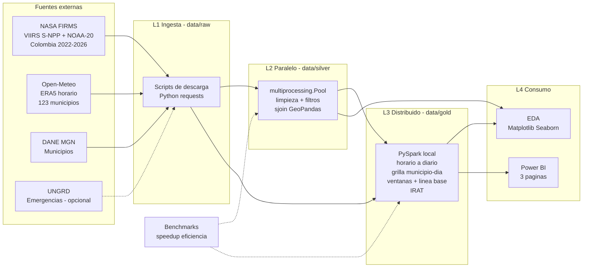
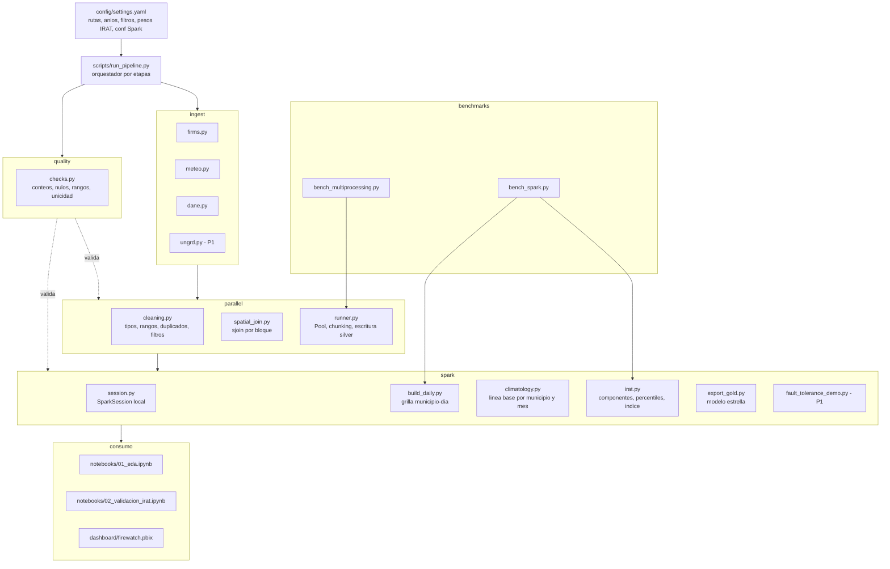
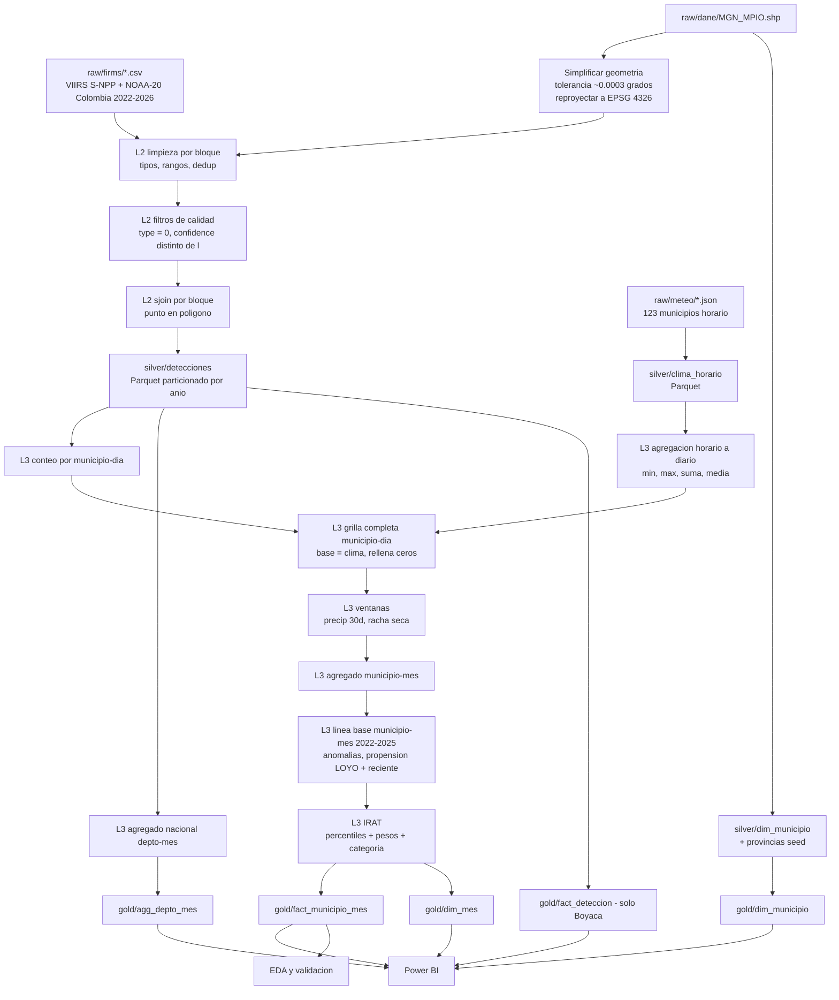
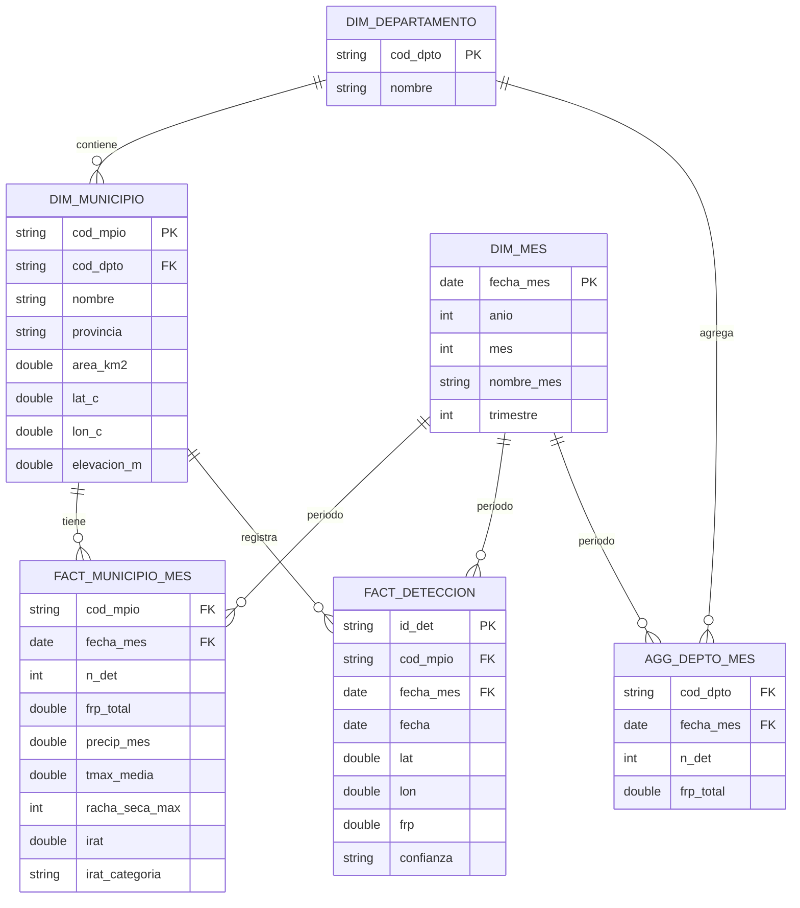

# FireWatch Boyacá — Documento de Arquitectura v1.0

**Estado:** congelado el 2 de noviembre de 2026 · **v1.1: ventana temporal 2022-01-01 → 2026-10-31 por indicación de la docente (ADR-0004, ver Plan de Implementación §0)** · Coherente con el *Plan Director v2.1* y con *Restricciones del proyecto*
**Principio rector:** cada componente existe porque cubre un requisito de la rúbrica (R1–R9). Lo que no cubre un requisito no se construye.

---

## 1. Arquitectura general

### 1.1 Estilo arquitectónico

Es un **pipeline batch por capas** que sigue el patrón *medallion*: `raw → silver → gold`. Sobre ese pipeline se apoya una **capa de consumo analítico**, y todo se despliega lógicamente sobre una **infraestructura de red simulada** en Packet Tracer.

| Alternativa evaluada | Decisión | Motivo |
|---|---|---|
| Medallion por lotes (raw/silver/gold) | ✅ **Elegida** | Es el estándar de la industria y fácil de explicar en el IEEE. Cada capa es reproducible por separado. Además, encaja con dos de las tres materias: silver se construye con procesamiento paralelo y gold con procesamiento distribuido. |
| Lambda/Kappa (streaming) | ❌ | Prohibido por alcance. FIRMS tiene latencia de horas, así que el lote diario es suficiente. |
| Base de datos relacional (PostgreSQL) como núcleo | ❌ | Añade operación sin aportar a la rúbrica. Parquet + CSV cubre el caso. |
| Microservicios / API | ❌ | Prohibido por las restricciones. |

### 1.2 Capas

| Capa | Responsabilidad | Requisito que cubre | Dueño |
|---|---|---|---|
| **L0 · Infraestructura de red** | Topología, VLSM, OSPF y despliegue lógico de los componentes | R2 | A |
| **L1 · Ingesta (raw)** | Descarga reproducible e inmutable de las fuentes | Fase 2 de los lineamientos | B |
| **L2 · Procesamiento paralelo (silver)** | Limpieza, filtros de calidad y enriquecimiento espacial con `multiprocessing` + GeoPandas | R3, R5 | B |
| **L3 · Procesamiento distribuido (gold)** | Spark local: agregación horario→diario, grilla municipio-día, ventanas, línea base, IRAT y agregados | R4, R5 | C |
| **L4 · Consumo analítico** | EDA (Matplotlib/Seaborn) y dashboard (Power BI) | R6, R7 | B (EDA) · C (BI) |
| **Transversal** | Configuración central, orquestación, calidad de datos, benchmarks y logging | R5, reproducibilidad | B + C |

### 1.3 Diagrama de arquitectura general



### 1.4 Por qué cada tecnología está en su capa (argumento clave para la sustentación)

- **multiprocessing en L2.** El cruce punto-en-polígono de **todas las detecciones de Colombia** (S-NPP + NOAA-20, 2022–2026: del orden de cientos de miles a ~1 millón de puntos, a confirmar con el gate del día 1) contra los ~1.120 municipios del país es CPU-bound. Además es *embarrassingly parallel*: cada bloque de puntos se procesa sin depender de los demás. Por eso da un speedup medible y honesto. Con solo Boyacá (decenas de miles de puntos) el cruce tardaría segundos, el overhead de crear procesos dominaría y el benchmark no tendría valor. **Por eso L2 procesa Colombia completa.**
- **Spark en L3.** Aquí aparecen las operaciones donde Spark aporta de verdad:
  - la agregación del clima **horario → diario** (≈ 5,2 millones de filas horarias → ≈ 217k filas diarias, con *shuffle*): es la carga distribuida principal (ADR-0003);
  - un join entre la grilla completa municipio-día (≈ 217k filas) y las detecciones;
  - funciones de ventana particionadas por municipio (sumas móviles y rachas secas);
  - agregaciones con *shuffle*;
  - líneas base por municipio y mes calendario (2022–2025).
  
  Spark en modo `local[N]` usa el mismo modelo de ejecución que un clúster (DAG, stages, tareas, particiones, linaje). Escalar a un clúster solo requiere cambiar la URL del master. Es el argumento que hay que dar si preguntan "¿esto es distribuido?".
- **GeoPandas fuera de Spark.** Las restricciones prohíben Sedona. Hacer el cruce espacial con UDFs de Shapely dentro de Spark sería lento por la serialización Python↔JVM y difícil de defender. Con la separación elegida, cada tecnología hace aquello en lo que es fuerte.

---

## 2. Diagrama de componentes



**Reglas de diseño de los componentes:**
1. **Una sola fuente de configuración** (`settings.yaml`). Ningún módulo usa rutas, años ni pesos escritos en el código. Así el IEEE, el código y el dashboard usan exactamente los mismos parámetros.
2. **Las etapas son idempotentes.** Volver a ejecutar una etapa sobrescribe su salida sin efectos colaterales. Es requisito para poder repetir los benchmarks.
3. **Funciones puras en `parallel/`**, definidas a nivel de módulo `.py`. Es obligatorio para el método *spawn* que usa Windows y evita el fallo típico de multiprocessing dentro de Jupyter.
4. **Los benchmarks llaman al mismo código de producción.** Solo cambian el número de procesos o núcleos. Nunca se mide una versión "de juguete".
5. **Contratos de datos entre capas** (sección 9). Así B y C trabajan en paralelo sin bloquearse.

---

## 3. Flujo de datos



### 3.1 Etapas, volúmenes y controles de calidad

Los volúmenes marcados con `~` son estimaciones que se confirman el día 1.

| # | Etapa | Entrada → Salida | Volumen | Controles de calidad (`quality/checks.py`) |
|---|---|---|---|---|
| 1 | Ingesta FIRMS | CSV por país 2022–2025 (SP) + Archive Download 2026 (SP + NRT) → `raw/firms/` | Del orden de 10⁵–10⁶ filas (confirmar en el gate) | Columnas esperadas; meses de 2022-01 a 2026-10 sin huecos; marca SP/NRT |
| 2 | Ingesta clima | API → `raw/meteo/` (horario) | 123 × 42.360 h ≈ **5,2 M filas** | Sin horas faltantes; rangos físicos (precip ≥ 0, HR ∈ [0,100]) |
| 3 | Ingesta DANE | Shapefile → `raw/dane/` | ~1.120 polígonos | 123 municipios con código de departamento 15 |
| 4 | Limpieza + filtros (L2) | raw → memoria | — | Lat/lon dentro de la caja de Colombia; FRP > 0; dedup por (lat, lon, fecha, hora, satélite); % descartado por filtro, registrado en log |
| 5 | Cruce espacial (L2) | → `silver/detecciones` | ~10⁶ | % de puntos sin municipio < 1 % (deben ser bordes o mar) |
| 6 | Horario → diario + grilla municipio-día (L3) | silver → intermedio | 5,2 M → 123 × 1.765 ≈ **217k** | **Cada municipio tiene exactamente un registro por día** (unicidad); 24 horas por día |
| 7 | Municipio-mes + IRAT (L3) | → `gold/fact_municipio_mes` | 123 × 58 = **7.134** | IRAT ∈ [0,1]; suma de detecciones = conteo de silver de Boyacá |
| 8 | Exportación gold | Parquet + CSV | < 50 MB | Integridad referencial entre hechos y dimensiones |

**Reconciliación obligatoria (aparece en el IEEE):** el número de detecciones de Boyacá debe coincidir en tres puntos: silver, `fact_municipio_mes` y la tarjeta K1 de Power BI. Si no coinciden, hay un error en el pipeline.

### 3.2 Decisiones de procesamiento que hay que defender

- **Grilla completa con ceros.** La base del join es la tabla de clima (todos los municipio-día). Si se partiera de las detecciones, los días sin incendio desaparecerían y las correlaciones clima-detecciones quedarían sesgadas. Es el error más común en este tipo de proyectos.
- **Ventana temporal fija: 2022-01-01 → 2026-10-31** (58 meses completos; octubre de 2026 es el último mes completo antes de la entrega). Se parametriza en `settings.yaml`, de modo que cambiarla solo requiere tocar ese archivo.
- **Propensión histórica sin fuga de información (*leave-one-year-out*).** Para el mes *m* del año *a*, la propensión se calcula con todos los años de la ventana **excepto *a*** (quedan 3–4 años de referencia; ver §7.2). Si se incluyera el propio año, el índice "vería" el resultado que luego se usa para validarlo.
- **Simplificación de geometrías** con una tolerancia de ~0,0003° (≈33 m), menor que el píxel VIIRS de 375 m. Reduce memoria y tiempo por proceso sin alterar de forma material la asignación de municipio.
- **Asignación de bloques en multiprocessing:** bloques de tamaño fijo (por ejemplo, 100–200k filas) y no un bloque por año, porque los años tienen volúmenes muy distintos y eso desbalancea la carga. Cada proceso trabajador carga los polígonos una sola vez (función `initializer` del Pool) para no serializarlos con cada tarea.

---

## 4. Tecnologías por módulo

| Módulo | Tecnología | Versión objetivo | Justificación | Alternativa descartada |
|---|---|---|---|---|
| Lenguaje | Python | 3.11 | Compatible con todo el stack | 3.13 (algunas ruedas geoespaciales llegan tarde) |
| Configuración | YAML (`pyyaml`) | — | Legible y fácil de versionar | `.env` (no admite estructuras) |
| Ingesta HTTP | `requests` | — | Simple y suficiente | `aiohttp` (complejidad innecesaria) |
| Tabular | pandas | 2.x | Estándar | Polars (fuera de las tecnologías permitidas) |
| Geoespacial | GeoPandas + Shapely 2 + pyogrio | 1.x / 2.x | Shapely 2 es vectorizado y `sjoin` usa índice STRtree | Sedona (prohibido) |
| Paralelo | `multiprocessing.Pool` (stdlib) | — | R3 explícito; cero dependencias | `concurrent.futures`, joblib (válidos, pero menos didácticos) |
| Almacenamiento | Parquet (`pyarrow`) | — | Columnar, comprimido, lo leen Spark y pandas | CSV en silver (lento, sin tipos) |
| Distribuido | PySpark en modo local | 3.5.x | Estable; permitido | Dask (no es Spark) |
| Runtime de Spark | Java | 17 | Soportado por Spark 3.5 | — |
| EDA | Matplotlib + Seaborn | — | R6 explícito | Plotly (no cuenta para R6) |
| BI | Power BI Desktop | Actual | R7 | Tableau (curva de aprendizaje) |
| Mapas en BI | Azure Maps visual → **plan B: Shape Map + TopoJSON** | — | Azure Maps puede estar bloqueado en cuentas universitarias | — |
| Red | Cisco Packet Tracer | 8.x | R2 | GNS3 (excesivo) |
| Versionado | Git + GitHub | — | Entregable obligatorio | — |
| Pruebas | `pytest` (mínimo) | — | Pruebas de limpieza e IRAT; demuestran rigor | — |

**Nota de compatibilidad:** se elige PySpark 3.5 + Java 17 en lugar de Spark 4.x porque hay más documentación y menos fricción en Windows con un plazo tan corto. Si C ya tiene Spark 4 funcionando, se queda con ese y se fija la versión en `requirements.txt`. **Hay que decidirlo el día 1 y no cambiarlo después.**

---

## 5. Fuentes de datos definitivas

| # | Fuente | Producto exacto | Cobertura | Campos usados | Rol | Estado |
|---|---|---|---|---|---|---|
| F1 | **NASA FIRMS** | VIIRS 375 m de **S-NPP y NOAA-20** (ambos cubren toda la ventana). 2022–2025: CSV anual por país (SP). 2026: Archive Download (SP hasta donde exista, NRT después; el SP llega con ~5 meses de rezago) | 2022-01-01 → 2026-10-31 | `latitude, longitude, acq_date, acq_time, satellite, confidence, frp, bright_ti4, bright_ti5, scan, track, daynight, type` (`type` solo existe en SP) | Variable objetivo / observación | **P0** |
| F2 | **Open-Meteo Historical Weather API** | Reanálisis ERA5 / ERA5-Land, **resolución horaria** (ADR-0003), consulta por centroide municipal | 2022-01-01 → 2026-10-31, 123 municipios | Horario: `temperature_2m`, `relative_humidity_2m`, `precipitation`, `wind_speed_10m`, `et0_fao_evapotranspiration`; además `elevation` (la API la devuelve en la respuesta). Los agregados diarios (máx, mín, suma, media) los calcula Spark | Covariables climáticas | **P0** |
| F3 | **DANE – Marco Geoestadístico Nacional** | Capa de municipios (con código DIVIPOLA) | Nacional | Código de municipio (5 dígitos), nombre, código de departamento, geometría | Cruce espacial, área (km²), centroides | **P0** |
| F4 | **Tabla de provincias de Boyacá** | Archivo semilla `config/provincias_boyaca.csv`, construido a mano a partir de fuente oficial de la Gobernación | 123 municipios | Código de municipio → provincia | Jerarquía para el drill-down | **P0** (~1 h) |
| F5 | **UNGRD** – consolidado de emergencias | Datos abiertos (datos.gov.co), evento "incendio de cobertura vegetal" | Boyacá, por año | Municipio, fecha, evento | Validación externa del IRAT | **P1** |

**Tratamiento SP frente a NRT (2026):** los datos NRT no traen `type`. Para filtrar las fuentes industriales en todo el periodo se construye una **máscara de fuentes estáticas** a partir de las detecciones SP 2022–2025 con `type = 2`, agrupadas en celdas de ~0,005°. Esa máscara se aplica a todas las detecciones, y se conserva la columna `proceso` (SP/NRT) para trazabilidad.

**Descartadas y por qué (para la sección II/III del IEEE):**
- **IDEAM DHIME:** estaciones con series incompletas, descarga manual y lenta, cobertura espacial desigual en Boyacá. ERA5 da continuidad espacio-temporal y está validado en la literatura.
- **MODIS (1 km):** otra resolución espacial; mezclarlo con VIIRS contaminaría los conteos.
- **NOAA-21:** entró en servicio dentro de la ventana; incluirlo crearía un salto artificial en la serie. S-NPP y NOAA-20 sí cubren la ventana completa, así que su combinación es homogénea en el tiempo.
- **Corine Land Cover / NDVI:** mejorarían el componente de combustible, pero requieren procesar rásters. Quedan como trabajo futuro y se mencionan como limitación.

**Limitaciones declaradas (sección de limitaciones del IEEE):**
1. Una detección FIRMS es una *anomalía térmica*, no un incendio confirmado.
2. Un centroide representa mal el clima de municipios grandes o con mucho relieve (por ejemplo, del piedemonte al páramo).
3. ERA5 suaviza los extremos locales.
4. Los pasos del satélite (≈ 01:30 y 13:30 hora local) no capturan los incendios de corta duración.
5. **Línea base corta (2022–2026, por indicación docente):** 4 años completos no constituyen una climatología estándar de 30 años. Las anomalías se interpretan como *relativas a la ventana*. La ventana incluye una fase La Niña (2022) y El Niño 2023–2024, lo que aporta contraste interanual (verificar con el índice ONI de NOAA y citarlo).

---

## 6. Repositorio (estructura de carpetas)

```
firewatch-boyaca/
├── README.md                     # qué es, cómo instalar, cómo ejecutar, resultados clave
├── LICENSE
├── requirements.txt              # versiones fijadas
├── .gitignore                    # data/**, *.parquet, .venv, checkpoints
├── config/
│   ├── settings.yaml             # rutas, años, bbox, filtros, pesos IRAT, conf Spark
│   └── provincias_boyaca.csv     # semilla manual municipio → provincia
├── data/                         # NO versionado (solo .gitkeep + README)
│   ├── raw/{firms,meteo,dane,ungrd}/
│   ├── silver/{detecciones,clima_horario,dim_municipio}/
│   └── gold/                     # Parquet + CSV para Power BI
├── src/firewatch/
│   ├── config.py
│   ├── ingest/      firms.py · meteo.py · dane.py · ungrd.py
│   ├── parallel/    cleaning.py · spatial_join.py · runner.py
│   ├── spark/       session.py · build_daily.py · climatology.py · irat.py · export_gold.py · fault_tolerance_demo.py
│   ├── quality/     checks.py
│   └── utils/       log.py · timing.py
├── scripts/
│   ├── download_all.py           # L1 completo
│   └── run_pipeline.py           # L1→L3 con flags --stage
├── benchmarks/
│   ├── bench_multiprocessing.py
│   ├── bench_spark.py
│   ├── results/                  # CSV crudos de cada corrida (versionados)
│   └── figures/                  # speedup.png, eficiencia.png, karp_flatt.png
├── notebooks/
│   ├── 01_eda.ipynb
│   └── 02_validacion_irat.ipynb
├── tests/
│   ├── test_cleaning.py
│   └── test_irat.py
├── dashboard/
│   ├── firewatch.pbix            # dueño único: C
│   ├── boyaca_municipios.topojson
│   └── theme.json
├── network/
│   ├── firewatch.pkt             # dueño único: A
│   ├── plan_direccionamiento.md
│   ├── configs/                  # running-config de cada router
│   └── evidencias/               # capturas de show ip route, ospf neighbor, ping
└── docs/
    ├── arquitectura.md           # este documento (los Mermaid se renderizan en GitHub)
    ├── diccionario_datos.md
    ├── adr/                      # registros de decisiones: 0001-era5, 0002-sjoin-multiprocessing, ...
    ├── ieee/                     # fuente EN y ES + PDFs
    └── poster/
```

**Convenciones:**
- Ramas `main` + `dev-<rol>`; *pull requests* con revisión de otro integrante.
- Commits con el formato `tipo(módulo): mensaje`.
- Los resultados de benchmark **se versionan**: son evidencia, y deben coincidir con el IEEE.

---

## 7. Índice de Riesgo Relativo de Anomalías Térmicas (IRAT)

### 7.1 Definición

- **Unidad de análisis:** municipio × mes (123 × 58 = 7.134 observaciones, de 2022-01 a 2026-10).
- **Fórmula:** IRAT = suma ponderada de componentes, cada uno transformado a su **rango percentil** en [0,1] y orientado de modo que *mayor valor = mayor riesgo*.
- **Uso:** el IRAT es un índice **relativo de priorización**, no una probabilidad.

| Código | Componente | Cálculo (en L3) | Signo | Peso | Justificación |
|---|---|---|---|---|---|
| **H** | Propensión histórica | 50 % · densidad media (detecciones por 100 km²) del municipio en ese mes calendario, **excluyendo el año evaluado** (LOYO) + 50 % · densidad de los **3 meses anteriores** (ventana `lag`, sin fuga) | + | **0,30** | En Colombia la mayoría de igniciones son de origen humano (quemas agrícolas). El término reciente compensa que la línea base LOYO tenga solo 3–4 años. |
| **P** | Déficit de precipitación | −(precipitación mensual − media del municipio en ese mes calendario, 2022–2025) | + (más seco = más riesgo) | **0,25** | La sequedad antecedente del combustible es el factor físico principal. |
| **D** | Racha seca máxima | Máximo de días consecutivos con precipitación < 1 mm (técnica *gaps-and-islands* con ventanas de Spark) | + | **0,15** | Captura la persistencia de la sequía, que el total mensual oculta. |
| **T** | Anomalía de temperatura máxima | Temperatura máxima media mensual − media del municipio en ese mes calendario | + | **0,15** | Mayor evapotranspiración y desecación. |
| **R** | Anomalía de humedad mínima | −(humedad relativa mínima media mensual − media del municipio en ese mes calendario) | + (más seca = más riesgo) | **0,10** | Afecta la humedad del combustible fino. |
| **W** | Viento máximo | Media mensual del viento máximo diario (percentil) | + | **0,05** | Propagación. Peso bajo por la incertidumbre de ERA5 en terreno montañoso. |

### 7.2 Decisiones metodológicas

- **Anomalías frente a valores absolutos.** Una temperatura de 25 °C es normal en Puerto Boyacá y extrema en un páramo. La anomalía respecto al propio municipio elimina el efecto de la altitud. **Este es un argumento de diseño fuerte para la sustentación.**
- **Diferencia simple en lugar de z-score (consecuencia de ADR-0004).** Con solo 4 años de referencia por municipio y mes, la desviación estándar se estima con n = 4 y es muy inestable: un z-score dividiría por una cifra ruidosa. Se usa la diferencia frente a la media, y la escala la normaliza después el rango percentil sobre todo el panel. La media de la línea base se calcula con los años completos 2022–2025, para que el 2026 parcial no sesgue los meses de noviembre y diciembre.
- **Percentiles frente a min-max.** Los percentiles son robustos a valores atípicos, y FRP y precipitación tienen colas muy pesadas.
- **Categorías:** quintiles del IRAT → Muy bajo, Bajo, Moderado, Alto, Muy alto.
- **Análisis de sensibilidad:** se compara con pesos iguales (1/6 cada uno) y con un índice "solo clima" (sin H). Se reporta el ρ de Spearman de cada versión. Si el índice "solo clima" correlaciona poco, eso se reporta como hallazgo: el régimen de incendios está dominado por la actividad humana.

### 7.3 Validación (sección de resultados del IEEE)

| Métrica | Definición | Para qué sirve |
|---|---|---|
| ρ de Spearman concurrente | ρ(IRAT del mes *t*, detecciones del mes *t*) | Poder explicativo |
| ρ de Spearman anticipado | ρ(IRAT del mes *t*, detecciones del mes *t*+1) | Utilidad operativa |
| Tasa de captura | % de detecciones que ocurren en municipio-mes clasificados Alto o Muy alto | Interpretable por un tomador de decisiones (es el KPI K5) |
| Contraste UNGRD (P1) | Correlación entre el IRAT anual y los eventos reportados | Validación externa |

**Referencia conceptual a citar:** el Canadian Fire Weather Index (Van Wagner, 1987) como marco de índices meteorológicos de peligro. El IRAT es una versión simplificada, guiada por datos, y debe declararse así.

---

## 8. KPIs y diseño del dashboard

### 8.1 KPIs

| ID | KPI | Fórmula (en DAX, sobre el modelo gold) | Pregunta de negocio | Página |
|---|---|---|---|---|
| **K1** | Detecciones de vegetación | `SUM(fact_municipio_mes[n_det])` | ¿Cuánta actividad térmica hubo? | 1 |
| **K2** | Variación interanual | Comparación **del mismo periodo** (año corrido): K1 de enero–mes M del año frente a enero–mes M del año anterior. Evita comparar el 2026 parcial contra el 2025 completo | ¿Está aumentando? | 1 |
| **K3** | FRP medio (MW) | `AVERAGE(fact_deteccion[frp])` | ¿Qué tan intensos son los eventos? | 1 |
| **K4** | Municipios en riesgo Alto o Muy alto | Conteo distinto de municipios con categoría ∈ {Alto, Muy alto} en el último mes filtrado | ¿Dónde actuar este mes? | 3 |
| **K5** | Tasa de captura del IRAT | Detecciones en municipio-mes Alto/Muy alto ÷ total de detecciones | ¿Funciona el índice? | 3 |
| **K6** | Participación de Boyacá en Colombia | Detecciones de Boyacá ÷ detecciones nacionales | ¿Qué peso tiene Boyacá en el país? | 1 |

R7 exige 3 KPI. Hay **6 definidos y 4 se muestran como tarjetas principales** (K1, K2, K4, K5).

### 8.2 Páginas (storytelling: qué pasa → dónde pasa → por qué y qué hacer)

| Página | Pregunta narrativa | Visuales | Interactividad |
|---|---|---|---|
| **1. Panorama** | ¿Qué está pasando? | Tarjetas K1, K2, K3, K6 · línea mensual 2022-01 a 2026-10 (anotando las fases La Niña / El Niño) · matriz de calor mes × año (estacionalidad) · barras de detecciones por provincia | Segmentadores de año y provincia; drill-down año→mes en la línea |
| **2. Territorio** | ¿Dónde pasa? | Mapa de puntos (`fact_deteccion`) o coroplético (Shape Map) · top 10 de municipios · dispersión de altitud frente a detecciones | Drill-down provincia→municipio; filtro cruzado entre el mapa y el ranking |
| **3. Clima y riesgo** | ¿Por qué pasa y dónde actuar? | Tarjetas K4, K5 · mapa por categoría de IRAT · combinado de precipitación (barras) y detecciones (línea) · tabla de municipios Alto/Muy alto con sus componentes | Segmentador de mes; tooltip con el desglose H/P/D/T/R/W; marcadores (P1) |

Así se cubren con holgura los mínimos de R7: **≥5 visuales (hay ~12), ≥3 KPI (6) y ≥2 tipos de interactividad (segmentadores, drill-down, filtrado cruzado, tooltips, marcadores).**

---

## 9. Tablas finales de Spark (contratos de datos)

### 9.1 Entradas de Spark (silver, producidas por L2 y L1)

**`silver.detecciones`** — Parquet particionado por `anio`. **Es el contrato entre B y C.**

| Columna | Tipo | Descripción |
|---|---|---|
| `id_det` | string | Hash de (lat, lon, acq_date, acq_time, satellite) |
| `lat`, `lon` | double | WGS84 |
| `fecha` | date | `acq_date` |
| `hora_utc` | int | `acq_time` (HHMM) |
| `anio`, `mes` | int | Derivados de la fecha |
| `daynight` | string | D/N |
| `confianza` | string | n/h (las *l* ya están filtradas) |
| `frp` | double | MW |
| `bright_ti4` | double | K |
| `cod_dpto` | string(2) | DIVIPOLA |
| `cod_mpio` | string(5) | DIVIPOLA; nulo si no cae en ningún municipio |
| `satelite` | string | `N` (S-NPP) / `N20` (NOAA-20) |
| `proceso` | string | `SP` / `NRT` |
| `fuente_estatica` | boolean | `true` si cae en la máscara de fuentes estáticas (estas filas se excluyen de gold) |

**`silver.clima_horario`** (~5,2 M filas): `cod_mpio` · `ts_local` (timestamp, America/Bogota) · `fecha` · `temp` · `rh` · `precip` · `wind` · `et0`. La clave (`cod_mpio`, `ts_local`) es única. Particionado por `anio`.

**`silver.dim_municipio`**: `cod_mpio` · `nombre` · `cod_provincia` · `provincia` · `area_km2` · `lat_c` · `lon_c` · `elevacion_m`.

### 9.2 Intermedias (no van a Power BI)

| Tabla | Grano | Contenido clave | Operación Spark relevante |
|---|---|---|---|
| `int.clima_diario` | municipio × día (~217k) | `tmax`, `tmean`, `precip` (suma), `rh_min`, `wind_max`, `et0` (suma) | `groupBy(cod_mpio, fecha)` sobre ~5,2 M filas horarias: **la operación con *shuffle* más pesada del pipeline** |
| `int.municipio_dia` | municipio × día (~217k) | Clima diario + `n_det` (0 si no hubo) + `frp_sum` + `precip_30d` + `dia_seco` + `id_racha` | Left join con base completa; `Window.partitionBy(cod_mpio).orderBy(fecha)` con suma móvil de 30 días y *gaps-and-islands* |
| `int.linea_base` | municipio × mes calendario (123 × 12) | **Media 2022–2025** de precip, tmax, rh_min; densidad total y por año (para LOYO) | `groupBy` + agregaciones; LOYO = (total − año) / (n_años − 1). Sin desviación estándar (ver §7.2) |

### 9.3 Salidas gold (Power BI + EDA)

**`gold.fact_municipio_mes`** — grano municipio × mes, 7.134 filas (123 × 58).

| Columna | Tipo | Descripción |
|---|---|---|
| `cod_mpio` | string | Clave foránea a `dim_municipio` |
| `fecha_mes` | date | Primer día del mes; clave foránea a `dim_mes` |
| `n_det` | int | Número de detecciones |
| `frp_total`, `frp_medio` | double | Intensidad |
| `det_100km2` | double | Densidad |
| `precip_mes`, `tmax_media`, `rh_min_media`, `wind_max_media` | double | Clima agregado |
| `racha_seca_max` | int | Días |
| `anom_precip`, `anom_tmax`, `anom_rh` | double | Anomalías (diferencia frente a la línea base 2022–2025) |
| `det_3m_previos` | double | Densidad de los 3 meses anteriores (componente reciente de H) |
| `c_H`, `c_P`, `c_D`, `c_T`, `c_R`, `c_W` | double [0,1] | Componentes en percentil |
| `irat` | double [0,1] | Índice |
| `irat_categoria` | string | Muy bajo … Muy alto |
| `irat_orden` | int | 1–5, para ordenar en Power BI |

**`gold.fact_deteccion`** — solo Boyacá; grano: una detección. Columnas: `id_det` · `cod_mpio` · `fecha` · `fecha_mes` · `hora_utc` · `lat` · `lon` · `frp` · `confianza` · `daynight` · `satelite`.

**`gold.agg_depto_mes`** — grano departamento × mes (~33 × 58). Columnas: `cod_dpto` · `fecha_mes` · `n_det` · `frp_total`.

**`gold.dim_municipio`** — 123 filas; igual que la silver.

**`gold.dim_departamento`** — ~33 filas: `cod_dpto` · `nombre`.

**`gold.dim_mes`** — grano mensual, 58 filas (2022-01 → 2026-10). Columnas: `fecha_mes` · `anio` · `mes` · `nombre_mes` · `trimestre` · `fase_enso` (La Niña / Neutral / El Niño, a partir del ONI de NOAA; P1, opcional).

> **Decisión cerrada:** se usa una sola `dim_mes` (como refleja el diagrama ER de §10). Las tres tablas de hechos se relacionan con ella a través de `fecha_mes`. Esto evita ambigüedades de granularidad en Power BI.

### 9.4 Parámetros de Spark (también son variables del benchmark)

| Parámetro | Valores del benchmark | Valor de producción |
|---|---|---|
| `master` | `local[1]`, `local[2]`, `local[4]`, `local[N]` | `local[*]` |
| `spark.sql.shuffle.partitions` | 4, 8, 16, 200 (el 200 por defecto muestra el overhead con datos medianos) | 2–3 × núcleos |
| `spark.driver.memory` | — | 4 g (suficiente para la ventana 2022–2026) |
| Etapa medida | **Agregación horario→diario** (principal) + pipeline gold completo | — |

**Optimizaciones a mencionar:** *broadcast join* de `dim_municipio`; formato Parquet columnar con *predicate pushdown* por `anio`; `cache()` de `int.municipio_dia` porque se reutiliza.

---

## 10. Diagrama entidad-relación simplificado (modelo estrella gold)



**Reglas del modelo en Power BI:**
- Relaciones 1:N con dirección de filtro simple (de la dimensión al hecho).
- Sin relaciones muchos-a-muchos.
- La jerarquía provincia → municipio vive en `DIM_MUNICIPIO`; la jerarquía año → trimestre → mes vive en `DIM_MES`.
- La relación departamento → municipio solo se usa para Boyacá. `AGG_DEPTO_MES` alimenta únicamente el KPI K6.

---

## 11. Despliegue lógico sobre la red (integración L0 ↔ L1–L4)

El sistema es un **único nodo de procesamiento** (Spark en modo local). En Packet Tracer se representa cada rol lógico como un servidor en el segmento correspondiente. Las direcciones exactas se definen en el diseño de red (siguiente entregable).

| Segmento (VLSM) | Sitio / router | Dispositivos | Componente lógico que aloja |
|---|---|---|---|
| Centro de datos | Tunja / R-TUNJA | SRV-INGESTA, SRV-PROCESAMIENTO, SRV-ALMACENAMIENTO, SRV-BI | L1, L2+L3 (multiprocessing + Spark local), data/silver+gold, Power BI |
| Analistas | Tunja / R-TUNJA | PCs del equipo de datos | Desarrollo y EDA |
| Gestión del riesgo (CDGRD) | Tunja / R-TUNJA | PCs y portátiles | Consumidores del dashboard |
| Sede regional Duitama | R-DUITAMA | PCs (oficina ambiental / bomberos) | Consumidores |
| Sede regional Sogamoso | R-SOGAMOSO | PCs | Consumidores |
| Internet | R-ISP | SRV-FIRMS-SIM, SRV-METEO-SIM (HTTP) | Fuentes externas simuladas |
| Enlaces WAN | Entre routers | /30 punto a punto | OSPF área 0 |

**Argumento de escalabilidad (para CPD y para Redes):** el segmento del centro de datos se dimensiona con hosts libres para añadir nodos worker. Pasar de `local[*]` a un clúster standalone solo implica conectar workers en ese segmento y cambiar la URL del master. **El diseño de red ya contempla el crecimiento aunque hoy no se implemente** (Docker multinodo está prohibido por las restricciones).

---

## 12. Riesgos arquitectónicos residuales

| Riesgo | Mitigación de diseño |
|---|---|
| El volumen nacional de FIRMS es mayor de lo esperado y satura la RAM en L2 | Lectura por bloques (`chunksize`) + escritura incremental en Parquet; nunca se carga todo en memoria |
| El cruce multiproceso consume demasiada RAM (geometrías copiadas en cada proceso) | Geometrías simplificadas + carga única por proceso (`initializer`); número de procesos ≤ núcleos físicos |
| Granularidad mixta en Power BI | Una sola `DIM_MES` (sección 10) |
| El IRAT queda dominado por H y el clima pierde relevancia | Análisis de sensibilidad; se reporta como hallazgo, no como fallo |
| Las relaciones entre tablas no se cumplen | Controles de integridad referencial en `export_gold.py` antes de publicar gold |
