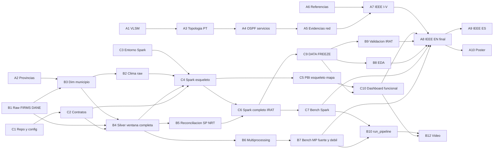

# FireWatch Boyacá — Plan de Implementación (fase de ejecución)

**Inicio de la ejecución:** lunes 2 de noviembre de 2026, 13:00
**Documentos base:** Arquitectura v1.0 (congelada) · Plan Director v2 · Restricciones del proyecto
**Precedencia:** el cronograma diario de este documento (§8) **reemplaza** al §8 del Plan Director v2. Todo lo demás de ese plan sigue vigente.
**v1.1 (2 nov, 12:30):** ventana de datos **2022-01-01 → 2026-10-31** por indicación de la docente (ADR-0004). El cronograma se adelanta 1 día.

---

## 0. Reglas de la fase de ejecución

1. **La arquitectura está congelada.** Cualquier cambio requiere un registro de decisión (ADR) de una página en `docs/adr/` y el visto bueno de los otros dos integrantes. Sin ADR, no hay cambio.
2. **Definición de "terminado" (DoD), común a todos los entregables:**
   - está en `main` mediante un *pull request* revisado por otro integrante;
   - cumple su criterio de aceptación;
   - se ejecuta desde una terminal limpia siguiendo el README;
   - si genera números, estos coinciden con lo que irá al IEEE.
3. **Reunión diaria de 10 minutos a las 21:00** (videollamada o chat). Cada uno responde: qué cerré, qué cierro mañana, qué me bloquea. Las tareas se gestionan en un tablero de GitHub Projects con los IDs de este documento.
4. **Regla de las 2 horas:** si alguien lleva 2 horas bloqueado, lo dice en el grupo. Nadie pierde una tarde entera en silencio.

### ADR-0003 (nueva, resuelve la nota * del §5 de Arquitectura)

**Problema:** no está confirmado que Open-Meteo entregue la humedad relativa mínima como variable diaria.

**Decisión:** se descarga `relative_humidity_2m` en resolución **horaria** y Spark la agrega a mínimo diario.

**Consecuencias:**
- Con la ventana de ADR-0004: 123 municipios × 42.360 horas ≈ **5,2 millones de filas horarias**. Esto le da a Spark una carga distribuida real: una agregación con *shuffle* sobre millones de filas. R4 queda cubierto con mucha holgura sin depender del volumen de FIRMS.
- Se descargan **todas** las variables en horario (`temperature_2m`, `relative_humidity_2m`, `precipitation`, `wind_speed_10m`, `et0_fao_evapotranspiration`), y Spark calcula todos los agregados diarios. Así hay un solo formato de descarga y Spark asume trabajo de verdad.
- Costo: una descarga más pesada (riesgo de límite de la API, ver §9).

### ADR-0004: Ventana temporal 2022-01-01 → 2026-10-31 (indicación de la docente)

**Contexto:** la docente pide trabajar solo con datos desde 2022 para no sobrecargar los equipos. Se fija el **31 de octubre de 2026** como corte: es el último mes completo antes de la entrega, y así no queda un mes a medias distorsionando los agregados mensuales.

**Evaluación de impacto:**

| Pregunta | Respuesta | Fundamento |
|---|---|---|
| **1. ¿Se siguen cumpliendo los requisitos de Spark (R4)?** | **Sí, con holgura.** | El clima horario solo suma ≈ **5,2 M filas** (más de 50 veces el umbral de 100k) y supera con amplitud los 10 MB. FIRMS de Colombia con S-NPP + NOAA-20 suma del orden de cientos de miles de filas más (confirmar en el gate). R4 ya no depende de FIRMS. |
| **2. ¿Hay volumen suficiente para los benchmarks?** | **Spark: sí. Multiprocessing: probablemente sí, con dos ajustes.** | Spark: la agregación horario→diario sobre 5,2 M filas es una carga medible. Multiprocessing: el cruce espacial de Colombia (cientos de miles de puntos contra ~1.120 polígonos) debería tardar decenas de segundos en secuencial, que es suficiente. **Ajuste 1:** se mide la etapa L2 completa (lectura + limpieza + cruce + escritura), no solo el cruce. **Ajuste 2:** además del escalado fuerte, se añade **escalado débil** (Gustafson: el tamaño crece con *p*). Así se cubre "escalabilidad" de forma explícita y sin depender del volumen. **Regla del gate:** si la etapa L2 secuencial tarda menos de 20 s, se reporta igualmente con honestidad: el overhead domina y se explica con Amdahl/Karp–Flatt. Eso también es un resultado académico. |
| **3. ¿Hace falta otra fuente de datos?** | **No.** | Añadir una fuente nueva introduce riesgo de integración. El volumen se mantiene con dos decisiones que no añaden fuentes: (a) incluir **NOAA-20**, que ya está en FIRMS, cubre toda la ventana y aproximadamente duplica las detecciones sin romper la homogeneidad de la serie; (b) descargar **todo el clima en horario** (ADR-0003). En la ventana 2012–2025 NOAA-20 se había excluido porque empezaba a mitad de la serie; en 2022–2026 ese problema desaparece. |
| **4. ¿Qué tareas se simplifican?** | Descargas, ejecución de silver, corridas de benchmark, esqueleto | Ver la tabla "Simplificaciones" más abajo. |
| **5. ¿Qué componentes de Spark se reducen?** | Línea base y configuración; **no** las operaciones que sustentan R4/R5 | Ver la tabla "Spark" más abajo. |
| **6. ¿Se puede acelerar el cronograma?** | **Sí, aproximadamente 1 día. No más.** | El ahorro está casi todo en tiempo de máquina y en las tareas de datos de B y C (unas 4–5 h de personas). Packet Tracer, Power BI, el IEEE, el póster y los ensayos tardan lo mismo con 4 años o con 14. Ese día **se usa como margen y no para ampliar el alcance**: todo entregable pasa del viernes 13 al **jueves 12**. |

**Nuevos riesgos que introduce la ventana corta (y cómo se mitigan):**

| Riesgo nuevo | Mitigación |
|---|---|
| La línea base de 4 años hace inestables los z-scores | Se usan **anomalías como diferencia simple** frente a la media 2022–2025, sin dividir por la desviación estándar; los percentiles normalizan después (Arquitectura §7.2) |
| La propensión LOYO solo tiene 3–4 años de referencia | H = 50 % LOYO + 50 % **densidad de los 3 meses anteriores** (Arquitectura §7.1) |
| 2026 mezcla datos SP y NRT, y los NRT **no traen `type`** | **Máscara de fuentes estáticas** construida con SP 2022–2025 (`type = 2`), más una columna `proceso` (Arquitectura §5) |
| Comparar el 2026 parcial contra años completos | K2 compara el **mismo periodo del año** (año corrido); la media de la línea base usa solo 2022–2025 |
| Pregunta del jurado: "¿4 años bastan?" | Respuesta preparada: es una restricción docente de recursos, declarada como limitación; las anomalías son relativas a la ventana; la ventana contiene La Niña 2022 y El Niño 2023–24, lo que da contraste climático interanual real (ODS 13). |

**Simplificaciones:**

| Tarea | Antes (2012–2025) | Ahora (2022–2026) | Ahorro |
|---|---|---|---|
| Descarga FIRMS | 14 CSV | 8 CSV (4 años × 2 satélites) + 1 solicitud para 2026 | ~0,5 h |
| Descarga del clima | 14 años; riesgo alto de límite de la API | ~4,8 años; se puede completar en una noche | ~0,5 h y menos riesgo |
| Esqueleto E1 | Solo 2024 y después ampliar | **Ventana completa desde el principio** (la fase "ampliar" desaparece) | ~1 h + elimina un paso de integración |
| Corridas de silver y benchmark de MP | Largas | Minutos; 5 repeticiones sin problema | Tiempo de máquina |
| Riesgo de memoria en Spark (X8) | Medio | Bajo | — |
| Modelo de Power BI | 168 meses | 58 meses; más ágil | — |

**Spark: qué se reduce y qué no:**

| Componente | Decisión | Motivo |
|---|---|---|
| Agregación horario→diario | **Se mantiene (pasa a ser la carga principal)** | Sostiene R4 y el benchmark |
| Grilla completa con ceros + ventanas (suma móvil de 30 días, rachas secas, `lag`) | **Se mantiene** | Son el núcleo analítico y demuestran Spark de verdad |
| Climatología con media y desviación | **Se reduce a "línea base" (solo media)** | Con n = 4 la desviación estándar no aporta |
| Agregado nacional por departamento (K6) | Se mantiene | Es barato y aporta contexto |
| Ajuste de memoria y estrategia de caché | **Se reduce** a 4 GB fijos y `cache()` solo en `int.municipio_dia` | La ventana cabe holgada |
| Valores del benchmark de particiones | Se reduce de 5 a 4 valores (4, 8, 16, 200) | Menos corridas, la misma conclusión |
| Demostración de tolerancia a fallos (P1) | Se mantiene | Vale lo mismo y es barata |

---

## 1. Estrategia de construcción: esqueleto de punta a punta primero

**No se construye capa por capa** (primero toda la ingesta, luego todo silver, luego todo Spark…). Se construye un **esqueleto ejecutable de punta a punta (*walking skeleton*)** directamente con **toda la ventana 2022-01 → 2026-10** (es lo bastante pequeña según ADR-0004), y después se profundiza.

| Fase | Qué se hace | Fecha |
|---|---|---|
| **E0 · Cimientos** | Repositorio, configuración, contratos de datos, entornos, descargas | Lun 2 – mar 3 |
| **E1 · Esqueleto** | Ventana completa: raw → silver → Spark (conteos municipio-mes + clima diario) → gold → **1 página de Power BI con el mapa funcionando** | **Mié 4, 20:00** |
| **E2 · Paralelizar** | multiprocessing + benchmark (escalado fuerte y débil) | Mié 4 – jue 5 |
| **E3 · Profundizar** | IRAT, benchmark Spark, tolerancia a fallos, EDA → *data freeze* | Jue 5 – **sáb 7** |
| **E4 · Consumir** | Dashboard completo, validación, IEEE | Dom 8 – mié 11 |
| **E5 · Cerrar** | ES, póster, video, release → **todo entregable el jueves 12**; ensayos | Jue 12 – dom 15 |

**Por qué es superior al enfoque por capas (decisión de líder técnico):**
- Los dos riesgos mortales del plan eran el **cruce espacial (mié 4)** y el **mapa de Power BI (lun 9)**. Con el esqueleto, **ambos se prueban el miércoles 4**. El riesgo del mapa se adelanta 5 días, y eso da tiempo de sobra para el plan B.
- Los problemas de integración aparecen el día 3 y no el día 10: tipos de datos, códigos DIVIPOLA como texto y no como número, fechas, rutas de Windows.
- C empieza a trabajar en Power BI con datos reales mucho antes, lo que reduce la presión sobre la ruta crítica de la segunda semana.

---

## 2. Orden exacto de desarrollo

| # | Paso | Resp. | Fase | Salida verificable |
|---|---|---|---|---|
| 1 | Repositorio con la estructura de Arquitectura §6, `.gitignore`, `requirements.txt` con versiones fijadas, `settings.yaml` inicial | C | E0 | `git clone` + instalación funcionan en los 3 equipos |
| 2 | `docs/diccionario_datos.md` con los contratos del §9 de Arquitectura (silver y gold) | C | E0 | Documento revisado por B |
| 3 | Descargas raw (§4) + *gate* de volumen | B | E0 | `data/raw/*` + nota con los conteos |
| 4 | Plan VLSM + `provincias_boyaca.csv` | A | E0 | Tabla de subredes + CSV de 123 filas |
| 5 | Dimensión de municipios (silver): Boyacá con provincia, área y centroide | B | E0 | 123 filas, sin nulos |
| 6 | Descarga del clima horario (2022-01-01 → 2026-10-31) para los 123 centroides | B | E0–E1 | `data/raw/meteo/` completo y verificado |
| 7 | Limpieza + filtros + máscara de fuentes estáticas + cruce espacial **secuencial, ventana completa** | B | E1 | `silver/detecciones/` (anio = 2022…2026) |
| 8 | Job Spark esqueleto: silver → agregación horario→diario + conteo municipio-mes → gold CSV | C | E1 | `gold/*.csv` con 58 meses |
| 9 | Power BI esqueleto: modelo mínimo + **mapa** + 1 tarjeta KPI | C | E1 | Captura del mapa con datos reales |
| 10 | Topología PT + direccionamiento | A | E1 | `.pkt` con todos los equipos y direcciones |
| 11 | Reconciliación SP/NRT 2026 (conteos por mes; sin huecos ni saltos) | B | E1 | Nota en `docs/notas/` |
| 12 | Versión con multiprocessing (mismo resultado que la secuencial, comprobado) | B | E2 | Prueba de igualdad de salidas |
| 13 | Spark: grilla completa con ceros, ventanas, línea base | C | E3 | `int.municipio_dia` sin duplicados |
| 14 | OSPF + DHCP + servicios + verificación | A | E2 | Capturas `show ip route` / `ping` / `tracert` |
| 15 | Benchmark de multiprocessing (escalado fuerte p = 1, 2, 4, 8 + escalado débil) | B | E2 | `benchmarks/results/mp_*.csv` + 4 figuras |
| 16 | IRAT + exportación gold completa | C | E3 | `fact_municipio_mes` validada |
| 17 | Benchmark Spark + demostración de tolerancia a fallos (P1) | C | E3 | `spark_*.csv` + capturas de la Spark UI |
| 18 | EDA (7 gráficos) | B | E3 | `01_eda.ipynb` ejecutado de principio a fin |
| 19 | **DATA FREEZE** | C+B | E3 | *Tag* `data-freeze` en git |
| 20 | Dashboard completo (3 páginas) | C | E4 | Cumple R7 |
| 21 | Validación del IRAT (Spearman, captura, sensibilidad) | B | E4 | `02_validacion_irat.ipynb` |
| 22 | IEEE en inglés (redacción incremental desde el sábado 7) | A (+B, C) | E3–E4 | PDF v1.0 el jueves 12 |
| 23 | `run_pipeline` + README + prueba en máquina limpia | B | E4 | Registro de una ejecución completa |
| 24 | IEEE en español, póster, video, release v1.0 | A, B | E5 | PDFs + MP4 + *tag* `v1.0` |
| 25 | Ensayos + banco de preguntas Saber Pro | Todos | E5 | 2 ensayos cronometrados |

---

## 3. Qué construir primero (hoy, lunes 2)

En este orden, porque cada cosa desbloquea a otra persona:

1. **Repositorio y contratos de datos (C).** Sin estructura común, B y C escriben código incompatible. Con el diccionario de datos acordado, B y C pueden trabajar en paralelo desde mañana.
2. **Descarga de FIRMS + gate de volumen (B).** Es el primer eslabón de la ruta crítica y además resuelve la mayor incertidumbre del proyecto.
3. **Descarga del DANE → centroides (B).** Sin centroides no se puede pedir el clima, que es la descarga más lenta.
4. **Plan VLSM (A).** No depende de nada y libera a A para montar la topología mañana.
5. **Tabla de provincias (A).** Se pasa de B a A para descargar a B, que va al 100 % de su capacidad.
6. **Entornos de software (todos).** Que cada uno compruebe hoy que sus herramientas funcionan (§4.2).

---

## 4. Datasets que se descargan HOY

### 4.1 Datos

| ID | Dataset | Dónde y cómo | Parámetros exactos | Destino | Verificación inmediata | Resp. |
|---|---|---|---|---|---|---|
| **DS-01** | NASA FIRMS — resumen anual por país (2022–2025) | `https://firms.modaps.eosdis.nasa.gov/country/` (CSV anual por país, sin login) | Sensores **VIIRS S-NPP** y **VIIRS NOAA-20**, país **Colombia**, años **2022, 2023, 2024 y 2025** (8 archivos) | `data/raw/firms/<sensor>_<año>_colombia.csv` | 1) Existen las columnas `latitude, longitude, acq_date, acq_time, confidence, frp, daynight` **y `type`**. 2) **Conteo de filas por año y satélite** → *gate*. 3) Cada año cubre de enero a diciembre. | B |
| **DS-01b** | FIRMS Archive Download (**2026, obligatorio**) | `https://firms.modaps.eosdis.nasa.gov/download/` (autenticación con código enviado al correo) | Región: Colombia · VIIRS S-NPP y NOAA-20 · **2026-01-01 → 2026-10-31** · CSV (incluye SP hasta donde exista y NRT después) | `data/raw/firms_2026/` | **Solicitarlo HOY:** la solicitud puede tardar en procesarse. Verificar qué meses llegan como SP y cuáles como NRT. Si DS-01 no trae `type`, pedir también 2022–2025 por esta vía. | B |
| **DS-02** | DANE MGN — municipios | Geoportal del DANE → Descargas → Marco Geoestadístico Nacional (versión más reciente), nivel municipio, Shapefile o GeoPackage | Nacional | `data/raw/dane/` | ~1.120 municipios; **123 con código de departamento 15**; anotar el sistema de coordenadas (CRS) original; geometrías válidas | B |
| **DS-03** | Provincias de Boyacá | Fuente oficial de la Gobernación de Boyacá (citarla en el IEEE) | 123 municipios → provincia | `config/provincias_boyaca.csv` (`cod_mpio, municipio, provincia`) | 123 filas; los códigos coinciden con DS-02; códigos guardados como **texto de 5 dígitos** (para no perder el cero inicial en otros departamentos) | A |
| **DS-04** | Open-Meteo — **prueba** | Historical Weather API (`/v1/archive`) para Tunja, un año | Horario: `temperature_2m, relative_humidity_2m, precipitation, wind_speed_10m, et0_fao_evapotranspiration` · `timezone=America/Bogota` | `data/raw/meteo/_test/` | La respuesta trae `elevation`; no hay nulos; las unidades son las esperadas; **anotar el modelo de reanálisis que devuelve** | B |
| **DS-05** | Open-Meteo — **completo** | Mismos parámetros, 123 centroides, **2022-01-01 a 2026-10-31** | Peticiones por municipio (o por lotes de coordenadas) con pausas entre ellas y caché local | `data/raw/meteo/<cod_mpio>.json` | 123 archivos; 1.765 días = **42.360 horas** por municipio | B (empieza hoy en la noche; debería terminar en la misma noche) |
| **DS-06** | UNGRD — consolidado de emergencias (P1) | datos.gov.co → buscar "consolidado emergencias UNGRD" | Archivo completo | `data/raw/ungrd/` | Existen eventos de "incendio de cobertura vegetal" en Boyacá | A (10 minutos; solo descargar y guardar) |

**Gate de volumen (decisión a las 20:00 de hoy):**
R4 ya está garantizado por el clima horario (5,2 M filas). El gate de FIRMS decide solo **cómo se presenta el benchmark de multiprocessing**:
- **≥ 300k detecciones** (S-NPP + NOAA-20, Colombia, ventana completa) → escalado fuerte y débil tal como está planeado.
- **Entre 100k y 300k** → se mide la etapa L2 completa (no solo el cruce) y se da más peso al escalado débil.
- **< 100k** (muy improbable) → se reporta igualmente, con el análisis de overhead (Amdahl/Karp–Flatt) como hallazgo principal.

### 4.2 Entornos (cada integrante, hoy)

| Resp. | Software | Comprobación de "listo" |
|---|---|---|
| A | Cisco Packet Tracer 8.x · cuenta de Overleaf con la plantilla **IEEE Conference Template** | Abrir un `.pkt` vacío y guardarlo; compilar la plantilla en Overleaf |
| B | Python 3.11, entorno virtual, `requirements.txt` (pandas, geopandas, shapely 2, pyogrio, pyarrow, matplotlib, seaborn, requests, pyyaml) | Leer DS-02 con GeoPandas y dibujarlo |
| C | Lo mismo que B + **Java 17** + **PySpark (versión fijada)** + **Power BI Desktop** | `spark.range(10**7).count()` termina sin errores; Spark UI abre en `localhost:4040`; Power BI abre un CSV |

**Anotar hoy los núcleos físicos y lógicos y la RAM de la máquina de C.** Son datos obligatorios del IEEE (sección de configuración experimental).

---

## 5. Entregables por integrante

### A · Redes y Documento

| ID | Entregable | Ruta | Fecha límite | Criterio de aceptación |
|---|---|---|---|---|
| A1 | Plan VLSM (tabla de subredes) | `network/plan_direccionamiento.md` | Lun 2 | Sin solapamientos; cada subred justificada por número de hosts + crecimiento; enlaces WAN /30 |
| A2 | Tabla de provincias | `config/provincias_boyaca.csv` | Lun 2 | 123 filas, verificadas contra DS-02 |
| A3 | Topología PT con direccionamiento | `network/firewatch.pkt` | Mié 4 | 4 routers; servidores con el nombre que define Arquitectura §11 |
| A4 | Enrutamiento y servicios | `network/configs/*.txt` | Vie 6 | OSPF con vecinos activos; DHCP; HTTP/DNS en los servidores |
| A5 | Evidencias de red | `network/evidencias/` | Vie 6 | Capturas de `show ip route`, `show ip ospf neighbor`, ping y tracert de extremo a extremo |
| A6 | Bibliografía | `docs/ieee/referencias.bib` | Sáb 7 | ≥12 referencias candidatas, ≥8 de ellas indexadas (IEEE, Elsevier, MDPI, etc.) |
| A7 | IEEE EN, secciones I–V | `docs/ieee/` | Lun 9 | Redactadas, con figuras de arquitectura y de red |
| A8 | IEEE EN completo | `docs/ieee/firewatch_en.pdf` | **Mié 11** | 6–10 páginas; plantilla IEEE correcta; limitación de la ventana 2022–2026 declarada |
| A9 | IEEE ES | `docs/ieee/firewatch_es.pdf` | **Jue 12** | Revisado técnicamente por B y C |
| A10 | Póster A1 | `docs/poster/firewatch_poster.pdf` | **Jue 12** | En inglés; incluye arquitectura, red, speedup, mapa e IRAT |

### B · Data Engineering y Paralelo

| ID | Entregable | Ruta | Fecha límite | Criterio de aceptación |
|---|---|---|---|---|
| B1 | Datos raw + nota del gate | `data/raw/` + `docs/notas/gate_volumen.md` | Lun 2 | DS-01, 02, 04 verificados; **DS-01b (2026) solicitado** |
| B2 | Clima raw completo | `data/raw/meteo/` | Mar 3 (mañana) | 123 archivos × 42.360 horas |
| B3 | Dimensión de municipios + silver de clima horario | `data/silver/` | Mar 3 | Unicidad de la clave (`cod_mpio`, `ts_local`) |
| B4 | **Silver de detecciones, ventana completa (secuencial)** | `data/silver/detecciones/` | **Mar 3, 22:00** | Cumple el contrato; menos del 1 % sin municipio; máscara de fuentes estáticas aplicada |
| B5 | Reconciliación SP/NRT 2026 | `docs/notas/sp_nrt_2026.md` | Mié 4 | Sin huecos mensuales ni saltos anómalos en el cambio de SP a NRT |
| B6 | Runner con multiprocessing | `src/firewatch/parallel/` | Mié 4 | Salida **idéntica** a la secuencial (prueba automática) |
| B7 | Benchmark de multiprocessing | `benchmarks/results/` + `figures/` | **Jue 5** | Escalado fuerte p = 1, 2, 4, 8 × 5 repeticiones (speedup, eficiencia, Karp–Flatt) + escalado débil |
| B8 | EDA | `notebooks/01_eda.ipynb` | **Dom 8** | 7 gráficos, cada uno con su hallazgo (incluye el contraste La Niña 2022 frente a El Niño 2023–24) |
| B9 | Validación del IRAT | `notebooks/02_validacion_irat.ipynb` | Lun 9 | Spearman (mismo mes y mes siguiente), tasa de captura, sensibilidad |
| B10 | Pipeline reproducible | `scripts/run_pipeline.py` + README | **Mar 10** | Probado en una máquina limpia (la de A) |
| B11 | Texto de VI-A y parte de EDA del IEEE | `docs/ieee/` | **Lun 9** | Entregado a A |
| B12 | Video de la demo | `docs/demo/firewatch_demo.mp4` | **Jue 12** | 4–6 minutos |

### C · Spark y Power BI

| ID | Entregable | Ruta | Fecha límite | Criterio de aceptación |
|---|---|---|---|---|
| C1 | Repositorio + `settings.yaml` + `requirements.txt` | raíz del repositorio | Lun 2 | Los 3 integrantes clonan e instalan sin problemas |
| C2 | Diccionario de datos (contratos) | `docs/diccionario_datos.md` | Lun 2 | Aprobado por B |
| C3 | Entorno Spark verificado + especificaciones de la máquina | `docs/notas/entorno.md` | Lun 2 | Prueba rápida de Spark superada |
| C4 | **Job Spark esqueleto + gold de la ventana completa** | `src/firewatch/spark/` | **Mié 4** | Agregación horario→diario funcionando + CSV gold de municipio-mes con 58 meses |
| C5 | **Power BI esqueleto con mapa** | `dashboard/` | **Mié 4, 20:00** | El mapa funciona con la visual original o con Shape Map + TopoJSON |
| C6 | Pipeline Spark completo (grilla con ceros, ventanas, línea base, IRAT) | `src/firewatch/spark/` | **Vie 6** | Pasa las verificaciones de Arquitectura §3.1 |
| C7 | Benchmark Spark | `benchmarks/results/` | Sáb 7 | `local[1/2/4/N]` × particiones (4, 8, 16, 200), con la etapa horario→diario; comparación con pandas |
| C8 | Demostración de tolerancia a fallos (P1) | `src/firewatch/spark/fault_tolerance_demo.py` + capturas | Sáb 7 | Se ve el reintento de una tarea en la Spark UI |
| C9 | **Gold congelado** | `data/gold/` + *tag* `data-freeze` | **Sáb 7, 18:00** | Pasa la reconciliación de Arquitectura §3.1 |
| C10 | Dashboard funcional | `dashboard/firewatch.pbix` | **Lun 9** | Cumple R7 |
| C11 | Dashboard final | `dashboard/firewatch.pbix` | **Mar 10** | Storytelling + tooltips (+ marcadores P1) |
| C12 | Texto de VI-B y VII del IEEE | `docs/ieee/` | **Mar 10** | Entregado a A |
| C13 | Banco de preguntas Saber Pro | `docs/sustentacion/banco_saberpro.md` | **Jue 12** | ≥5 por materia, con respuesta razonada |

---

## 6. Tareas que se pueden empezar YA (próximas 4–6 horas)

**Si eres A:**
1. Instalar Packet Tracer y abrir Overleaf con la plantilla IEEE (30 min).
2. Contar los hosts de cada segmento según Arquitectura §11, añadir un 30–50 % de margen de crecimiento, ordenarlos de mayor a menor y asignar las subredes VLSM. Entregable A1 (1,5 h).
3. Construir `provincias_boyaca.csv`, A2 (1 h).
4. Descargar DS-06 de UNGRD (10 min).
5. Enviar al docente las 5 preguntas del Plan Director §11 (10 min).

**Si eres B:**
1. **Primero, solicitar DS-01b** (2026 por Archive Download; 10 min), porque su procesamiento puede tardar.
2. Descargar DS-01: los 8 archivos de FIRMS de 2022–2025 (20–40 min).
3. Descargar DS-02 del DANE (20 min).
4. Abrir un archivo de FIRMS y comprobar que existe la columna `type`, y luego contar las filas por año y satélite. **Es el gate, y se reporta al grupo antes de las 20:00** (1 h).
5. Hacer la prueba DS-04 de Open-Meteo con Tunja (30 min).
6. Calcular los centroides de los 123 municipios y dejar lanzada la descarga DS-05 (1 h + tiempo de descarga).

**Si eres C:**
1. Crear el repositorio con la estructura de Arquitectura §6 e invitar a los otros dos; configurar la protección de `main` (exige *pull request*) (45 min).
2. Escribir `settings.yaml` (rutas, **`fecha_inicio: 2022-01-01`, `fecha_fin: 2026-10-31`**, satélites `[N, N20]`, código de departamento 15, filtros, pesos IRAT, parámetros de Spark) y `requirements.txt` (45 min). **Ningún módulo puede tener años escritos en el código: todos se leen de aquí.**
3. Escribir `docs/diccionario_datos.md` copiando los contratos del §9 de Arquitectura, con tipos exactos (1 h).
4. Instalar Java 17, PySpark y Power BI, y hacer la prueba rápida de Spark; anotar las especificaciones de la máquina (1 h).
5. Crear el tablero de GitHub Projects con los IDs A1–A10, B1–B12 y C1–C13 (30 min).

---

## 7. Dependencias

**Ruta crítica:** C1 → C2 → B4 → C4 → C6 → **C9 (sáb 7)** → C10 → A8 (mié 11) → A9/A10 (jue 12) → ensayos.

**Tareas que NO bloquean a nadie** (y que por tanto pueden absorber retrasos): B6/B7 (multiprocessing), A3–A5 (red), B8 (EDA), C8 (tolerancia a fallos).

**Dependencias cruzadas que hay que vigilar:**

| Quién espera | A quién | Qué | Hora límite |
|---|---|---|---|
| B | A | `provincias_boyaca.csv` | Lun 2, 22:00 |
| B y C | C | Diccionario de datos | Lun 2, 22:00 |
| C | B | Silver completo + clima horario | Mar 3, 22:00 |
| C | B | Reconciliación SP/NRT | Mié 4, 22:00 |
| B y A | C | Gold congelado | **Sáb 7, 18:00** |
| A | B y C | Textos de las secciones VI y VII | **Lun 9 (B) · Mar 10 (C)** |

---

## 8. Cronograma diario (reemplaza el §8 del Plan Director v2)

| Fecha | Fase | A | B | C | Hito / control |
|---|---|---|---|---|---|
| **Lun 2** | E0 | A1 VLSM, A2 provincias, DS-06 (filtrado a 2022+), correo al docente, instalaciones | **DS-01b primero**, DS-01, DS-02, **gate**, DS-04, lanzar DS-05 | C1, C2, C3, tablero | 🚩 20:00 gate · 21:00 reunión de arranque |
| **Mar 3** | E0→E1 | A3 topología (equipos y cableado) | B2 cierre del clima (mañana), B3, **B4 silver de la ventana completa** | C4: agregación horario→diario (con B3) y conteos municipio-mes | 🚩 22:00 B4 entregado |
| **Mié 4** | E1→E2 | A3 direccionamiento de interfaces | B5 reconciliación SP/NRT, **B6 multiprocessing** | C4 gold → **C5 PBI + mapa** | 🚩 **20:00 ESQUELETO DE PUNTA A PUNTA** (demo interna de 15 min) |
| **Jue 5** | E2→E3 | A4 OSPF + DHCP | **B7 benchmark** fuerte y débil (correr de noche) | C6: grilla con ceros, ventanas, línea base | — |
| **Vie 6** | E3 | A4 servicios, A5 evidencias, ACL (P1) | Revisión del top 10 del IRAT con C, inicio de B8 | **C6: IRAT** | **Red terminada** |
| **Sáb 7** | E3 | A6 referencias, inicio de A7 | B8 EDA (≥5 gráficos) | C7 benchmark Spark, C8 tolerancia a fallos, **C9 DATA FREEZE (18:00)** | — |
| **Dom 8** | E4 | A7 (I–IV) | B8 cierre (7 gráficos) | C10: modelo completo + DAX | **Punto de control 1** (90 min) + cross-training 1 |
| **Lun 9** | E4 | A7 V + figura de arquitectura | B9 validación, B11 texto VI-A | **C10 dashboard funcional** | — |
| **Mar 10** | E4 | Inicio de A8 (VI–IX) | B10 `run_pipeline` + prueba en la máquina de A | C11 dashboard final, C12 texto | **Punto de control 2** |
| **Mié 11** | E4 | **A8 IEEE EN v1.0** | Revisión técnica de A8, guion del video, UNGRD (P1) | Revisión técnica de A8, figuras del póster, marcadores (P1) | Cross-training 2 |
| **Jue 12** | E5 | A9 ES + A10 póster | **B12 video**, *tag* `v1.0` | C13 banco Saber Pro, apoyo con el póster | **TODO ENTREGABLE (22:00)** |
| **Vie 13** | E5 | **Margen** + ensayo 1 | **Margen** + ensayo 1 | **Margen** + ensayo 1 | Ensayo 1 cronometrado |
| **Sáb 14** | E5 | Ensayo 2 + correcciones | Ensayo 2 + correcciones | Ensayo 2 + correcciones | Ensayo 2 cronometrado |
| **Dom 15** | E5 | PDFs finales | Respaldo en USB | Verificación del `.pbix` | Paquete final listo |
| **Lun 16** | — | — | — | — | Entrega (festivo: **confirmar la fecha**) |

---

## 9. Riesgos que pueden retrasar la ejecución

| # | Riesgo | Señal temprana | Respuesta preparada |
|---|---|---|---|
| X1 | Los CSV anuales de FIRMS no traen la columna `type`, o DS-01b (2026) tarda en llegar | Revisión de DS-01 el lunes; DS-01b sin respuesta el martes | Sin `type`: máscara de fuentes estáticas por recurrencia espacial (misma celda de ~0,005° con detecciones en muchos días de ≥3 años distintos), documentada. Si 2026 no llega el miércoles: el esqueleto sigue con 2022–2025, 2026 se incorpora en cuanto llegue (es solo una partición más) |
| X2 | Límite de uso de Open-Meteo con el clima horario | Errores HTTP 429 | Pausas entre peticiones + caché por municipio + reanudar donde se quedó; terminar el martes en la mañana. Con la ventana 2022–2026 el riesgo es bajo |
| X2b | El cambio de SP a NRT en 2026 produce un salto artificial en los conteos | Reconciliación B5 | Marcar en el dashboard los meses NRT; si el salto supera ±30 % frente al mismo mes de otros años sin explicación climática, documentarlo como limitación |
| X3 | Geometrías inválidas o CRS distinto en DANE | Error en el cruce o puntos sin municipio | `make_valid` + reproyectar a EPSG:4326 antes de simplificar; verificarlo el lunes con un gráfico |
| X4 | Códigos DIVIPOLA leídos como número (se pierde el 0 inicial, por ejemplo `05001`) | Joins vacíos | El contrato los fija como **texto**; leerlos siempre con `dtype=str` |
| X5 | Fechas de FIRMS en UTC | Desfase de un día en los bordes | VIIRS pasa ~01:30 y ~13:30 hora local (06:30 y 18:30 UTC), así que el desfase es despreciable. Se documenta y se usa `acq_date` sin ajustar |
| X6 | multiprocessing falla en Windows | `RuntimeError` / procesos colgados | Funciones en módulos `.py` + `if __name__ == "__main__"`; los benchmarks nunca se corren desde Jupyter |
| X7 | Benchmark ruidoso (antivirus, navegador, ahorro de energía) | Desviación estándar > 10 % | Correrlo de noche, conectado a la corriente, en modo alto rendimiento, con 1 corrida de calentamiento descartada |
| X8 | Spark se queda sin memoria al pasar de horario a diario | `OutOfMemoryError` | Leer solo las columnas necesarias; `spark.driver.memory` de 4–6 g; escribir el resultado intermedio en Parquet en vez de mantenerlo en caché |
| X9 | Conflictos de git o binarios sobrescritos | Pérdida de cambios en `.pkt` o `.pbix` | Un solo dueño por binario; *pull requests* pequeños; nunca `push --force` sobre `main` |
| X10 | Un integrante se enferma o tiene parciales | Falta a la reunión diaria | Respaldos definidos (Plan Director §5) + recorte de emergencia (Plan Director §10) |
| X11 | El docente no responde | Sin respuesta el miércoles 4 | Asumir la opción más exigente: IEEE bilingüe y todo listo el jueves 12 |
| X12 | Retrasos en el esqueleto del miércoles 4 | B4 sin entregar el martes a las 22:00 | C construye el esqueleto sobre el CSV raw de 2025 con una asignación de municipio provisional por caja delimitadora, para no detener el aprendizaje de Power BI |

---

## 10. Primer paso oficial de la ejecución

**Hoy a las 21:00, reunión de arranque (30 min):**
1. Confirmar quién es A, B y C (C debe tener Windows y la máquina con más núcleos).
2. Revisar el resultado del gate.
3. Aprobar el diccionario de datos.
4. Confirmar ADR-0003.
5. Activar el tablero.

A partir de ahí, el proyecto se gestiona solo con los IDs de este documento.
